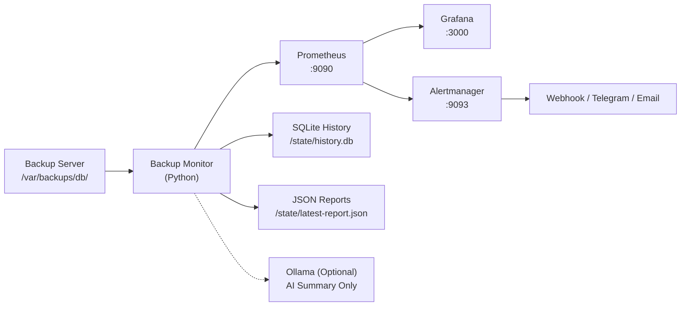

# Backwatch

Production-grade automated backup health monitoring, storage projection, integrity verification, and retention management system.

## Overview

**Backwatch** is a deterministic Python-based system that automatically discovers, monitors, and validates database backups stored in a hierarchical directory structure. It detects stale backups, corrupt archives, size anomalies, tracks `df -hT` mount storage & 30-day capacity projections, and manages retention — all based on actual filesystem timestamps, never folder dates.

> [!IMPORTANT]
> **ACTUAL FILESYSTEM TIMESTAMP > FOLDER DATE.** A file under `2026/11/22/` with mtime `2026-11-19` is treated as a Nov 19 backup. The system never trusts directory names as proof of backup creation date.

## Architecture



### Components

| Component | Purpose | Port |
|-----------|---------|------|
| **backup-monitor** | Discovery, health checks, retention, metrics | 9108 |
| **Prometheus** | Metrics collection and alerting rules | 9090 |
| **Grafana** | Dashboards and visualization | 3000 |
| **Alertmanager** | Alert routing and notifications | 9093 |
| **Ollama** (optional) | AI summarization of deterministic results | 11434 |

## Backup Directory Structure

The system monitors a real backup server with this structure:

```
/var/backups/db/
├── 192.0.2.10/           ← IP-based server directory
│   └── 2026/
│       └── 11/
│           └── 22/
│               ├── postgres_prod/     ← Backup group (auto-discovered)
│               │   ├── orders.sql.gz
│               │   ├── batches.sql.gz
│               │   └── ...
│               └── analytics_db/
│                   └── analytics.sql.gz
├── 192.0.2.30/
├── 192.0.2.40/
├── SPECIAL_ARCHIVE/            ← Special (non-IP) directory
├── backup.txt              ← IGNORED (not a backup file)
└── helper-script.sh          ← IGNORED (not a backup file)
```

### Automatic Discovery

The system **automatically discovers** all backup groups. No manual configuration of individual databases is needed.

The canonical structure `<BACKUP_ROOT>/<IP>/YYYY/MM/DD/<BACKUP_GROUP>/` is auto-discovered:

- `server` = IP directory name (e.g., `192.0.2.10`)
- `folder_date` = constructed from `YYYY/MM/DD` path
- `backup_group` = subdirectory name (e.g., `postgres_prod`)

Non-IP directories (e.g., `SPECIAL_ARCHIVE`, `custom-project`) require explicit configuration under `special:` in the config file.

## Backup File Allow-List

> [!IMPORTANT]
> Only files matching the allow-list are monitored. Everything else is ignored.

**Default patterns:**
| Pattern | Monitored |
|---------|-----------|
| `*.sql` | ✅ Yes |
| `*.sql.gz` | ✅ Yes |
| `*.dump` | ✅ Yes |
| `*.backup` | ✅ Yes |
| `*.tar.gz` | ✅ Yes |
| `*.tgz` | ✅ Yes |
| `*.zip` | ✅ Yes |
| `*.txt` | ❌ Ignored |
| `*.sh` | ❌ Ignored |
| `*.md` | ❌ Ignored |
| `*.log` | ❌ Ignored |

Patterns are configurable in `config/config.yml`:

```yaml
backup_file_patterns:
  - "*.sql"
  - "*.sql.gz"
  - "*.dump"
  - "*.backup"
  - "*.tar.gz"
  - "*.tgz"
  - "*.zip"
```

## Timestamp Behavior

### mtime is the Primary Freshness Indicator

The system uses **actual filesystem modification time (mtime)** to determine backup freshness.

```
Folder path:   2026/11/22/postgres_prod/
File:          backup.sql.gz
Actual mtime:  2026-11-20 03:10

→ System treats this as a Nov 20 backup (2+ days old), NOT Nov 22.
```

### Linux ctime vs Creation Time

> [!WARNING]
> On Linux, `ctime` is the **inode metadata-change time**, NOT creation time. The system correctly labels it and never confuses it with birth time.

| Field | Meaning | Used For |
|-------|---------|----------|
| `mtime` | File modification time | **Primary freshness** |
| `ctime` | Inode metadata-change time | Metadata tracking |
| `birth_time` | True creation time (if available) | Optional secondary info |

## Installation

### Prerequisites

- Docker and Docker Compose v2
- Access to the backup directory on the host

### Quick Start

```bash
# 1. Clone or copy the project
cd backup-health-monitor

# 2. Configure environment
cp .env.example .env
# Edit .env — set BACKUP_HOST_PATH to your backup directory

# 3. Review configuration
vi config/config.yml

# 4. Build and start
docker compose up -d --build

# 5. Verify
docker compose ps
docker logs -f backup-monitor
```

### Verify Discovery

```bash
# Check the generated report
docker exec backup-monitor cat /state/latest-report.json | python3 -m json.tool

# View logs
docker logs backup-monitor 2>&1 | head -50

# Check metrics
curl http://localhost:9108/metrics
```

### Access Dashboards

| Service | URL | Note |
|---------|-----|------|
| **Built-in Web UI** | http://localhost:9108/ | **Standalone dashboard** (zero Docker/Grafana needed) |
| **Grafana** | http://localhost:3000 | admin/admin (Docker stack) |
| **Prometheus** | http://localhost:9090 | Metrics & alerting rules |
| **Alertmanager** | http://localhost:9093 | Notifications & alert dispatch |
| **Metrics Endpoint**| http://localhost:9108/metrics | Prometheus scrape target |

---

## Bare-Metal / Linux VM Installation (Systemd — No Docker Required)

For environments where Docker is not installed or not desired, the system includes a fully automated systemd installer and hardened service unit.

### Automated Installation

Run the automated installer with your custom service name (default is **`BM`**):

```bash
cd backup-health-monitor

# Install with default service name "BM":
sudo bash systemd/install.sh

# Or explicitly specify any custom service name:
sudo bash systemd/install.sh BM
```

The installer automatically:
1. Installs OS dependencies (`python3`, `python3-venv`, `gzip`, `tar`, `unzip`, `curl`).
2. Creates an unprivileged system user and group (`backupmon`).
3. Deploys the code to `/opt/backup-health-monitor`.
4. Creates a dedicated Python virtual environment (`/opt/backup-health-monitor/venv`).
5. Installs configuration to `/etc/backup-health-monitor/config.yml` and `/etc/backup-health-monitor/backwatch.env`.
6. Creates the persistent database directory at `/var/lib/backup-health-monitor`.
7. Installs and enables the hardened service unit as **`BM.service`** (with automatic alias to `backup-health-monitor.service`).
8. Launches the service and starts the built-in Web UI on port `9108`.

### Managing the Custom Service (`BM`)

You can now use your custom service name **`BM`** for all `systemctl` and `journalctl` operations:

```bash
# Check service status
sudo systemctl status BM

# Follow live logs in journald
sudo journalctl -u BM -f

# Restart after editing /etc/backup-health-monitor/config.yml
sudo systemctl restart BM

# Stop or start service
sudo systemctl stop BM
sudo systemctl start BM
```

### Uninstallation

```bash
sudo bash systemd/uninstall.sh BM
```

---

## Built-in Web UI (Standalone Dashboard)

The monitor includes a **built-in responsive Web UI** served directly on port `9108` (`http://<server-ip>:9108/`). It has zero external dependencies (no Node.js, no Docker, no Grafana required), making it ideal for standalone or bare-metal deployments!

### Dashboard Features

- **Executive KPI Cards**: Real-time counts of Total Groups, Healthy (PASS), Warnings / Size Anomalies, Failures / Stale backups, Retention Candidates, and Total Backup Storage Volume.
- **Timestamp Integrity Rule**: Prominently highlights that actual filesystem `mtime` determines freshness, never directory names.
- **Interactive Group Table**:
  - Live search bar (by Server IP, backup group name, or folder date).
  - Quick filter buttons (`All`, `Failures Only`, `Warnings Only`, `Healthy Only`).
  - Columns: Health Status, Server IP, Backup Group, Folder Date, Latest Backup File, Actual `mtime`, Age in Hours (color-coded), File Count, Total Size, Integrity Status.
- **Deep Inspector Accordion**: Click on any backup group row to view exact file paths, Linux `ctime` (inode change time), true birth time (if supported), critical error logs, and size anomaly percentage deviations.
- **Retention Lifecycle Panel**: Displays candidates eligible for deletion, age in days, and safety check verdicts (DRY RUN vs BLOCKED with safety reasons).
- **AI Executive Briefing**: Displays factual natural-language summaries generated via OpenWebUI or Ollama.
- **On-Demand Scan**: Click the **⚡ Trigger Scan Now** button to start a background scan cycle immediately with live feedback.
- **Dual-Mode HTTP Server**: Serves the Web UI on `/` and `/dashboard` while simultaneously serving Prometheus metrics on `/metrics`.

## Configuration

Configuration file: `config/config.yml`

```yaml
backup_root: /backups
scan_interval_seconds: 3600

backup_file_patterns:
  - "*.sql"
  - "*.sql.gz"
  - "*.dump"
  - "*.backup"
  - "*.tar.gz"
  - "*.tgz"
  - "*.zip"

health:
  expected_interval_hours: 26
  minimum_file_size_bytes: 1
  size_anomaly_threshold_percent: 60

retention:
  enabled: true
  days: 7
  dry_run: true              # SAFE: nothing deleted by default
  minimum_good_backups: 2

restore_test:
  enabled: false
  frequency: weekly
  sample_count: 1

special:
  SPECIAL_ARCHIVE:
    path: /backups/SPECIAL_ARCHIVE
    expected_interval_hours: 26
    patterns:
      - "*.sql"
      - "*.sql.gz"

notifications:
  webhook: ""
  alertmanager_url: ""

ai:
  enabled: false
  url: "http://ollama:11434"
  model: "qwen2.5:7b"
```

### Environment Variable Overrides

| Variable | Description |
|----------|-------------|
| `BACKUP_ROOT` | Override backup root path |
| `BACKUP_HOST_PATH` | Host path for Docker mount |
| `SCAN_INTERVAL_SECONDS` | Override scan interval |
| `LOG_LEVEL` | Logging level (DEBUG, INFO, WARNING, ERROR) |
| `WEBHOOK_URL` | Notification webhook URL |
| `ALERTMANAGER_URL` | Alertmanager API URL |
| `OLLAMA_ENABLED` | Enable AI summarization |
| `OLLAMA_URL` | Ollama API URL |
| `OLLAMA_MODEL` | Ollama model name |
| `GRAFANA_ADMIN_USER` | Grafana admin username |
| `GRAFANA_ADMIN_PASSWORD` | Grafana admin password |

## Health Checks

### Health States

| State | Meaning |
|-------|---------|
| **PASS** | Backup files exist, fresh, integrity OK |
| **WARNING** | Size anomaly, unusual file count |
| **FAIL** | Missing, stale, corrupt, zero-byte |
| **UNKNOWN** | Not yet evaluated |

### Checks Performed

1. **Freshness** — newest file mtime within SLA (default 26h)
2. **File size** — zero-byte and minimum size detection
3. **Integrity** — gzip/zip/tar archive verification
4. **Size anomaly** — comparison against 7/30-day baseline
5. **Restore test** — optional disposable container restore

## Prometheus Metrics

Exposed on port `9108`:

| Metric | Type | Labels |
|--------|------|--------|
| `backup_group_healthy` | Gauge | server, backup_group |
| `backup_group_latest_age_hours` | Gauge | server, backup_group |
| `backup_group_file_count` | Gauge | server, backup_group |
| `backup_group_total_bytes` | Gauge | server, backup_group |
| `backup_group_size_anomaly` | Gauge | server, backup_group |
| `backup_retention_candidates` | Gauge | — |
| `backup_restore_test_success` | Gauge | — |
| `backup_restore_test_failure` | Gauge | — |
| `backup_scans_total` | Counter | — |
| `backup_failures_total` | Counter | — |
| `backup_total_groups` | Gauge | — |
| `backup_healthy_groups` | Gauge | — |
| `backup_warning_groups` | Gauge | — |
| `backup_failed_groups` | Gauge | — |

## Grafana Dashboard

Pre-provisioned dashboard shows:
- Total/Healthy/Failed/Warning groups
- Backup age over time
- Stale backups table
- Size trends and anomalies
- Integrity status
- Restore test results
- Retention candidates
- Failed groups by server

## Alertmanager

### Pre-configured Alerts

| Alert | Severity | Condition |
|-------|----------|-----------|
| `BackupMissing` | critical | No backup files found |
| `BackupStale` | critical | Age > 26 hours |
| `BackupSizeAnomaly` | warning | Size deviation > threshold |
| `BackupCorrupt` | critical | Integrity check failed |
| `RestoreTestFailed` | critical | Restore test failed |
| `TooManyFailedGroups` | critical | > 5 groups failing |

### Adding Telegram/Teams/Email

Edit `deploy/alertmanager/alertmanager.yml`:

```yaml
receivers:
  - name: "telegram"
    telegram_configs:
      - bot_token: "${TELEGRAM_BOT_TOKEN}"
        chat_id: ${TELEGRAM_CHAT_ID}
```

## Retention

### How It Works

1. Only targets canonical `IP/YYYY/MM/DD/` directories
2. Never deletes scripts, text files, or special directories
3. Uses folder date as retention partition (but verifies contents)
4. Enforces minimum-good-backup protection

### Safety Rules

> [!CAUTION]
> **Never enable destructive deletion without first verifying the discovery results.**

- `dry_run: true` by default — nothing is ever deleted initially
- Path validation prevents deletion outside `IP/YYYY/MM/DD` structure
- Minimum good backups protection prevents deleting the last N known-good backups
- Active backup failures block retention for affected servers

### Enabling Deletion

**Step 1:** Deploy with `dry_run: true` (default) and verify:

```bash
# Check discovered groups
docker exec backup-monitor cat /state/latest-report.json | python3 -m json.tool | grep -A5 '"retention_candidates"'

# Verify .sh/.txt/.md files are ignored
docker logs backup-monitor 2>&1 | grep -i "discovered"

# Check actual mtimes
docker logs backup-monitor 2>&1 | grep -i "stale\|pass\|fail"
```

**Step 2:** When satisfied, change mount to `:rw` and set `dry_run: false`:

```yaml
# docker-compose.yml — change :ro to :rw
- ${BACKUP_HOST_PATH}:/backups:rw

# config/config.yml
retention:
  dry_run: false
```

## Restore Testing

Restore testing uses **disposable Docker containers** — never production databases.

```yaml
restore_test:
  enabled: true
  frequency: weekly
  sample_count: 1
```

Supported formats:
- PostgreSQL: `.sql.gz`, `.sql`, `.dump`, `.backup`
- MySQL/MariaDB: `.sql.gz`, `.sql`

## AI Integration (Optional — OpenWebUI / Ollama / OpenAI)

> [!NOTE]
> AI is purely an optional reporting/summarization layer. It **never** decides whether a backup is valid, never performs retention deletion, and never executes arbitrary commands. Python deterministic checks always make 100% of the operational decisions.

The system natively supports **OpenWebUI** (with API key authentication), OpenAI-compatible gateways (vLLM, LocalAI), and direct **Ollama** instances.

### OpenWebUI with API Key Authentication

OpenWebUI exposes an OpenAI-compatible API that requires a Bearer token (`api_key`). To configure:

**Option A: Via `config/config.yml`:**
```yaml
ai:
  enabled: true
  url: "http://ai.example.local:8080/api"   # or http://openwebui:8080/v1
  model: "qwen2.5:7b"
  api_key: "sk-your-openwebui-api-key-here"   # OpenWebUI API Key
  api_type: "openai"                         # "openai", "ollama", or "auto"
```

**Option B: Via Environment Variables (Recommended for Secrets):**
```bash
# In .env or /etc/backup-health-monitor/backwatch.env:
AI_ENABLED=true
AI_URL=http://ai.example.local:8080/api
AI_MODEL=qwen2.5:7b
AI_API_KEY=sk-your-openwebui-api-key-here
AI_API_TYPE=openai
```

### Direct Ollama (Local / Docker Profile)

For unauthenticated or local Ollama instances:

```yaml
ai:
  enabled: true
  url: "http://ollama:11434"
  model: "qwen2.5:7b"
  api_key: ""
  api_type: "ollama"
```

Start the bundled Ollama container in Docker:
```bash
docker compose --profile ai up -d
```

## Persistent History

SQLite database at `/state/history.db` stores:
- Scan timestamps and results per group
- File counts and sizes for baseline calculations
- 7-day and 30-day baselines for size anomaly detection
- Retention action log

## Security

- Container runs as **non-root** user
- **Read-only** container filesystem (`read_only: true`)
- **All capabilities dropped** (`cap_drop: ALL`)
- **no-new-privileges** security option
- Backup mount is `:ro` by default (`:rw` only for retention deletion)
- **No `shell=True`** in subprocess calls
- Path traversal protection in retention
- No hardcoded secrets — environment variables only
- Input validation on all configuration values

### Backup Server Permissions

For monitoring-only:
```bash
# User needs read access to backup directory
chmod -R o+r /var/backups/db/
```

For retention deletion:
```bash
# User needs write access
chmod -R o+rw /var/backups/db/
```

## Troubleshooting

### No backup groups discovered

```bash
# Check backup root exists in container
docker exec backup-monitor ls -la /backups/

# Check for IP directories
docker exec backup-monitor ls -la /backups/ | grep -E '^\d'

# Verify YYYY/MM/DD structure
docker exec backup-monitor find /backups/192.0.2.10/ -maxdepth 3 -type d
```

### All backups showing as STALE

```bash
# Check actual file mtimes
docker exec backup-monitor stat /backups/192.0.2.10/2026/11/22/postgres_prod/*.sql.gz

# Verify expected_interval_hours setting
docker exec backup-monitor cat /app/config/config.yml | grep expected_interval
```

### Metrics not appearing in Prometheus

```bash
# Test metrics endpoint directly
curl http://localhost:9108/metrics | grep backup_

# Check Prometheus targets
curl http://localhost:9090/api/v1/targets
```

## Production Deployment

### Recommended Setup

```bash
# 1. Use .env for secrets
cp .env.example .env
# Edit BACKUP_HOST_PATH, GRAFANA_ADMIN_PASSWORD, WEBHOOK_URL

# 2. Start monitoring-only
docker compose up -d --build

# 3. Verify for 24-48 hours
docker logs -f backup-monitor

# 4. Check report
docker exec backup-monitor cat /state/latest-report.json

# 5. Enable retention (after verification)
# Edit config/config.yml: dry_run: false
# Edit docker-compose.yml: :ro → :rw
docker compose up -d
```

### Useful Commands

```bash
# Build and start
docker compose up -d --build

# Check status
docker compose ps

# View logs
docker logs -f backup-monitor

# View report
docker exec backup-monitor cat /state/latest-report.json

# Check metrics
curl -s http://localhost:9108/metrics | grep backup_group_healthy

# Restart after config change
docker compose restart backup-monitor

# Stop everything
docker compose down

# Start with AI
docker compose --profile ai up -d
```

## Development

### Running Tests

```bash
# Install dependencies
pip install -r requirements.txt
pip install pytest

# Run all tests
cd backup-health-monitor
pytest tests/ -v

# Run specific test category
pytest tests/test_freshness.py -v
pytest tests/test_allowlist.py -v
pytest tests/test_retention.py -v
```

### Project Structure

```
backup-health-monitor/
├── app/
│   ├── __init__.py
│   ├── main.py              # Main scan loop and entry point
│   ├── config.py            # YAML configuration loading
│   ├── database.py          # SQLite history persistence
│   ├── models.py            # Data models and health states
│   ├── metrics.py           # Prometheus metrics definitions
│   ├── checks/
│   │   ├── discovery.py     # Auto-discovery of backup groups
│   │   ├── filesystem.py    # Freshness and size checks
│   │   ├── integrity.py     # Archive integrity verification
│   │   ├── anomaly.py       # Size anomaly detection
│   │   ├── retention.py     # Retention management
│   │   └── restore.py       # Restore testing framework
│   ├── notifications/
│   │   ├── alerts.py        # Webhook and Alertmanager integration
│   │   └── alertmanager.py  # Alertmanager rule definitions
│   └── ai/
│       └── ollama.py        # Optional AI summarization
├── config/
│   └── config.yml           # Default configuration
├── deploy/
│   ├── prometheus/          # Prometheus config and alert rules
│   ├── grafana/             # Grafana provisioning and dashboards
│   └── alertmanager/        # Alertmanager configuration
├── tests/                   # Comprehensive pytest test suite
├── Dockerfile
├── docker-compose.yml
├── requirements.txt
├── .env.example
├── .gitignore
└── README.md
```

## Critical Rules

This system follows these inviolable rules:

1. ✅ **ACTUAL FILE mtime** determines backup freshness — never folder date
2. ✅ Linux `ctime` = inode metadata-change time — NOT creation time
3. ✅ Only allow-listed file patterns are monitored
4. ✅ Backup groups are auto-discovered — no manual database config
5. ✅ Retention only targets `IP/YYYY/MM/DD/` directories
6. ✅ AI only summarizes — never decides
7. ✅ Restore tests use disposable containers — never production
8. ✅ `dry_run: true` by default — nothing deleted initially
9. ✅ No `shell=True` — secure subprocess calls
10. ✅ No hardcoded secrets — environment variables only

## Quick Start (Debian / Ubuntu `.deb` Package)

Install **Backwatch** as a hardened systemd service (`BM.service`) with a single command:

```bash
sudo apt install -y ./backwatch_1.0.0_all.deb
```

Edit credentials and backup path in `/etc/backup-health-monitor/backwatch.env`:
```ini
BACKUP_ROOT=/var/backups/db
AUTH_ENABLED=true
AUTH_USERNAME=admin
AUTH_PASSWORD=your-strong-password
WEBHOOK_URL=https://discord.com/api/webhooks/...
```

Then restart and verify:
```bash
sudo systemctl restart BM
sudo systemctl status BM
```
Open **`http://<SERVER_IP>:9108`** and log in with your `AUTH_USERNAME` / `AUTH_PASSWORD`.

## Features

- **Integrated Dark-Mode Web UI (`:9108`):** Zero external CDN dependencies (100% offline/air-gapped ready).
  - **Database Catalog:** Logical database aggregation, actual size, `mtime`, and retention scopes.
  - **Folder & Project Tree:** Categorized dropdown and expandable directory tree showing consumed space and % share at every level.
  - **Storage (`df -hT`) & 30-Day Projection:** Live mount condition table (`Filesystem`, `Type`, `Size`, `Used`, `Avail`, `Use%`) and inline SVG linear capacity projection graph.
  - **Retention Lifecycle & Restore Verification:** Safe `dry_run: true` default with minimum-good-backup protection.
  - **Interactive AI Assistant & Executive Briefings:** Universal support for OpenAI, Anthropic Claude, OpenWebUI, and Ollama.
- **HTTP Basic Authentication (No DB):** Configured solely via environment variables (`AUTH_ENABLED`, `AUTH_USERNAME`, `AUTH_PASSWORD`). Healthcheck endpoints (`/healthz`, `/live`, `/ready`) remain open for probes.

## License

Internal use. All rights reserved.

---

**GitHub Repository:** https://github.com/cyraxabir/BackWatch
